<p align="center">
  
</p>

<p align="center">
  <a href="https://github.com/sharingankid">
    
  </a>
</p>

<p align="center">
  
  
  
</p>

---

## `$ cat about.md`

Étudiant à **Holberton School Toulouse** (cohorte C29), en route vers le titre **RNCP 6 – Concepteur Développeur d'Applications**.
Je construis des applications **fullstack** de bout en bout, avec une vraie affinité pour le **bas niveau** et la **cybersécurité**.

Passionné de PC depuis petit : j'ai commencé par démonter des consoles et écumer les forums de modding et de hardware pour pousser mes machines dans leurs retranchements. Cette curiosité est devenue un métier : aujourd'hui je veux comprendre comment les choses marchent *sous le capot*, pas juste les faire tourner.

```yaml
focus:      [fullstack, cybersécurité, systèmes & low-level]
en_ce_moment: BoxTrack — app de gestion de WODs pour CrossFit LAB (en production)
apprend:    [React, DevOps / CI-CD, Ansible, agents IA]
approche:   "Comprendre > exécuter sans réfléchir"
```

---

## `$ ls ./stack`

**Langages**

<p>
  
  
  
  
  
  
  
</p>

**Frameworks & données**

<p>
  
  
  
  
  
  
  
  
</p>

**Infra, DevOps & IA**

<p>
  
  
  
  
  
  
  
  
</p>

---

## `$ ls ./projets --sort=recent`

| Projet | Description | Stack |
|:--|:--|:--|
| 🏋️ **[BoxTrack](https://github.com/sharingankid/boxtrack)** | App web pour **CrossFit LAB** (Toulouse) : création des WODs par les coachs, historique public et vue `/screen` pour la TV de la salle. Projet de fin d'année avec [@Panaki-GILLOT](https://github.com/Panaki-GILLOT), **en production**. | React · Vite · PostgreSQL · Supabase · Vercel |
| ⚙️ **[DevOps Pipeline Lab](https://github.com/sharingankid/holbertonschool-hbtn-devops-pipeline-lab)** · **[Ansible](https://github.com/sharingankid/Configuration-Management-with-Ansible)** | Pipelines CI/CD et gestion de configuration automatisée. | GitHub Actions · Docker · Ansible |
| 🦾 **[LE BRAS](https://github.com/sharingankid/hackathon-le-bras)** | Hackathon *Full Stack Agentique IA* : agent IA *human-in-the-loop*. J'ai réalisé le front, avec [@Pierre1200](https://github.com/Pierre1200) au back. | FastAPI · JavaScript |
| 📺 **[androidTV_cleaner](https://github.com/sharingankid/androidTV_cleaner)** | App Android TV qui sauvegarde dossiers, données d'apps et infos système sur clé USB, et nettoie caches et fichiers temporaires, **sans root**. | Kotlin · Leanback |
| 🏬 **[HBntory](https://github.com/sharingankid/HBntory)** | Gestion de stock multi-branches avec un **agent IA** (MCP + LLM local) pour interroger le catalogue et la disponibilité en langage naturel. Avec [@Panaki-GILLOT](https://github.com/Panaki-GILLOT). | Flask · Docker · SQLite · Ollama |
| 🌍 **[Linguao](https://github.com/sharingankid/linguao)** | Traduction de langues mal prises en charge par les services classiques    | Flask · Ollama |
| 🐚 **[Simple Shell](https://github.com/sharingankid/holbertonschool-simple_shell2)** · 🖨️ **[Printf](https://github.com/sharingankid/holbertonschool-printf)** | Un interpréteur de commandes et une réimplémentation de `printf`, en C. | C |
| 🤖 **Bots Discord** | Bots de notifications automatiques multi-plateformes pour streamers, hébergés sur VPS. | Python · Linux |

---

## `$ git log --stats`

<p align="center">
  
  
</p>
<p align="center">
  
</p>

---

## `$ cat certifications.txt`

<p>
  
  
</p>

---

## `$ ./contact.sh`

<p>
  <a href="https://www.linkedin.com/in/kevin-rigal-80a331240/"></a>
  <a href="mailto:krigal323@gmail.com"></a>
  
</p>

<p align="center"><sub><code>// toujours en train d'optimiser</code></sub></p>
